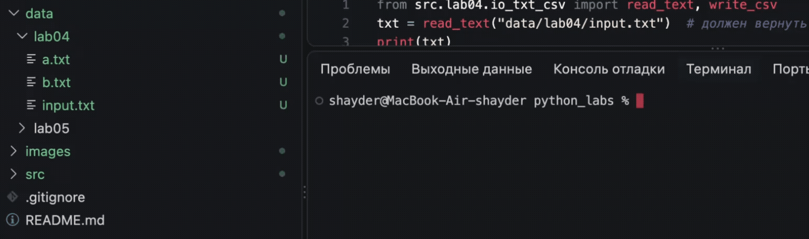
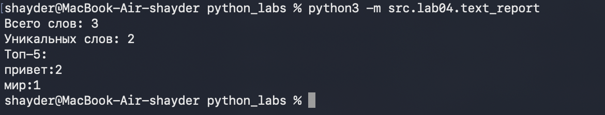

## ЛР4 — Файлы: TXT/CSV и отчёты по текстовой статистике
### * Задание 1 — io_txt_csv.py

#### В коде реализованы функции:
* read_text():
Читает файл и возвращает текст одной строкой. По умолчанию кодировка UTF-8.

```python
def read_text(path: str | Path, encoding: str = "utf-8") -> str:
    p = Path(path)
    #при необходимоости можно использовать другую кодировку(подать нужную в аргументе)
    try:
        return p.read_text(encoding=encoding)
    except FileNotFoundError:
        return "Файл не найден"
    except UnicodeDecodeError:
        return "Не удалось декодировать файл"
```

* write_csv():
Записывает строки в CSV. Если длины строк различаются, вызывает ValueError.

```python
def write_csv(rows: Iterable[Sequence], path: str | Path,
              header: tuple[str, ...] | None = None) -> None:
    p = Path(path)
    rows = list(rows)
    #проверка длины 
    if header is not None:
        length = len(header)
    elif rows:
        length = len(rows[0])
    else:
        length = 0
    for row in rows:
        if len(row) != length:
            raise ValueError('Все строки CSV должны иметь одинаковую длину')
    
    with p.open("w", newline="", encoding="utf-8") as f:
        w = csv.writer(f)
        if header is not None:
            w.writerow(header)
        for r in rows:
            w.writerow(r)

```

### Тест-кейсы:



### * Задание 2 — text_report.py

#### Скрипт читает файл, сохраняет частоты слов в CSV и печатает:
##### `Всего слов: <N>`
##### `Уникальных слов: <K>`
##### `Топ-5:`

Запуск: `python3 -m src.lab04.text_report`.

```python
from pathlib import Path

from lib.text import normalize, tokenize, count_freq, top_n
from lab04.io_txt_csv import read_text, write_csv


def main():

    input_path = Path("data/lab04/input.txt")
    output_path = Path("data/lab04/report.csv")

    text = read_text(input_path)

    text = normalize(text)

    words = tokenize(text)

    freq = count_freq(words)

    sorted_words = sorted(
        freq.items(),
        key=lambda item: (-item[1], item[0])
    )

    write_csv(
        sorted_words,
        output_path,
        header=("word", "count")
    )

    print("Всего слов:", len(words))

    print("Уникальных слов:", len(freq))

    print("Топ-5:")

    for word, count in top_n(freq, 5):
        print(f"{word}: {count}")


if __name__ == "__main__":
    main()
```

### Тест-кейсы:



